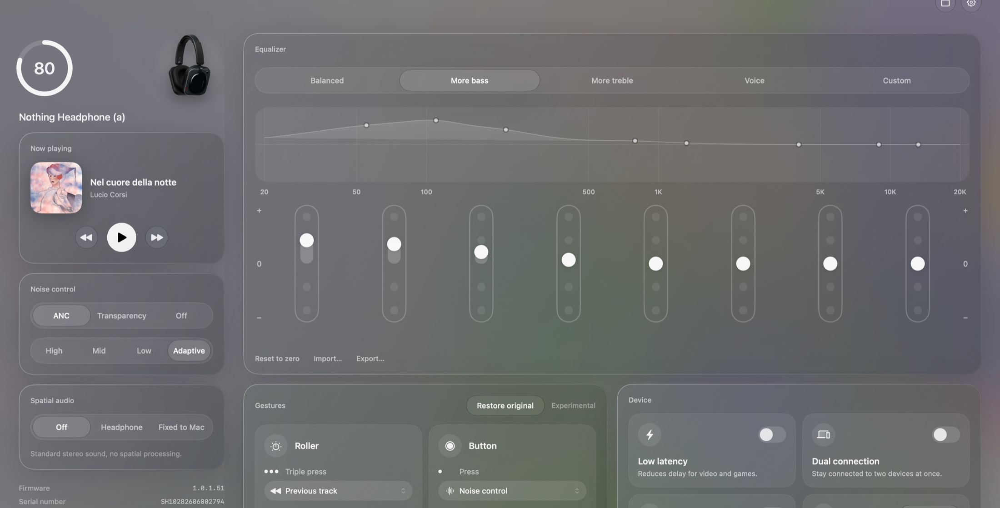
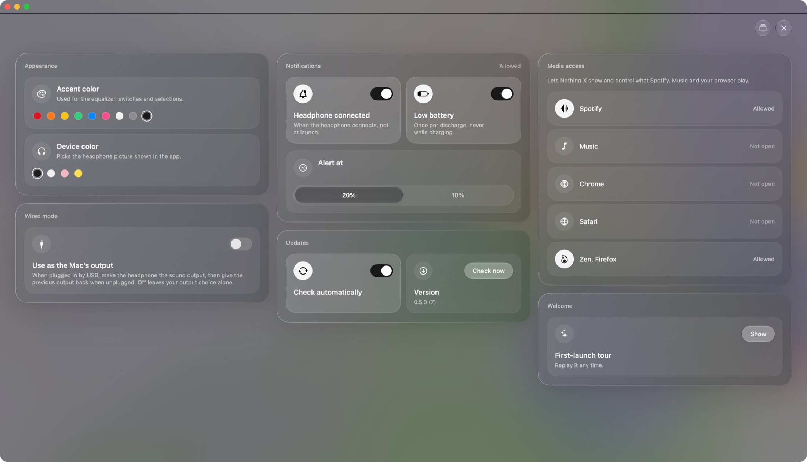
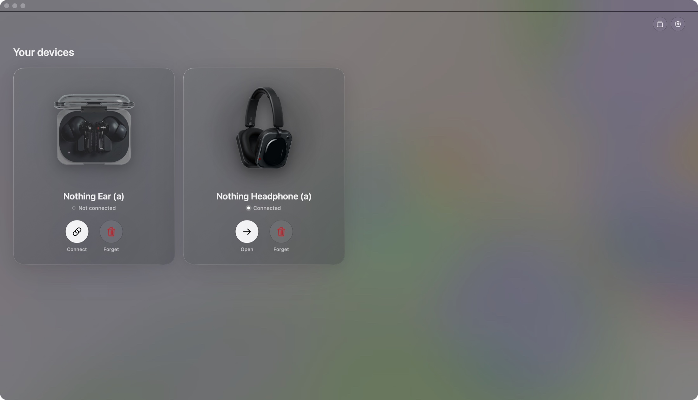
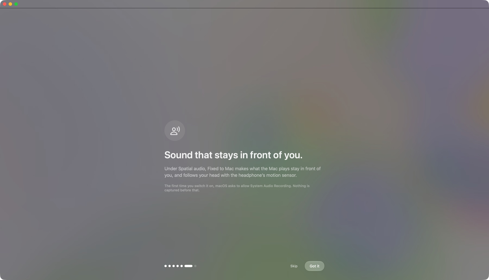

# Nothing X for Mac

A native macOS companion for Nothing headphones and earbuds: battery, noise control, equalizer, gestures,
spatial audio, a now-playing panel and a menu bar control, in a frosted-glass interface inspired by Nothing OS 5.



> **Unofficial.** This project is not affiliated with, endorsed by, or sponsored by Nothing Technology Limited.
> "Nothing" and "Nothing X" are trademarks of their respective owner.

## Credits

This project is a fork of [Senooy/nothing-x-mac](https://github.com/Senooy/nothing-x-mac) and exists thanks to
that work. The Bluetooth protocol reverse engineering, the RFCOMM transport, the frame codec, the equalizer
engine, the Mac anchor spatial audio, the software equalizer for wired mode, the notification rules and the
original application architecture all come from the upstream project, released under the MIT license. The
protocol notes in [`Protocol.md`](Protocol.md) build on the same public references the upstream author used.

## What this fork adds

### A new interface

- A frosted-glass design system: translucent cards, a wallpaper background, soft shadows, one tile language
  used everywhere (settings, gestures, device options, media access).
- Liquid Glass on macOS 26 and later, with a material fallback on macOS 14.2 and later.
- A choosable accent color and a choosable device color.
- A fully resizable window, up to full screen, with floating controls that stay put while the content scrolls.
- English, French and Italian.
- A new app icon and a new menu bar glyph.

### Nothing Ear (a) and Nothing Headphone (a)

- Per-model behavior: controls a device does not support are hidden instead of shown disabled
  (no custom equalizer or spatial audio on the earbuds, no find-my on earbuds).
- Per-unit battery: left earbud, right earbud and charging case each get their own ring.
- Per-side gestures for earbuds, with tap glyphs and action icons.
- Product pictures for each device and color.



### Devices

- A devices screen listing every Nothing device paired with the Mac, with connect, switch and forget.
- Event-driven connection detection instead of constant polling.
- The device list appears on its own when nothing is connected.



### Now playing

- Shows what is playing in Spotify and Music with cover art, title and artist.
- Shows YouTube from Chrome, Safari, Zen and Firefox, with the video thumbnail where the browser allows it.
- Play, pause, next and previous from the app, and from the menu bar panel.
- Access is requested one app at a time, from the first-launch tour or from Settings. Nothing is read until
  you allow it.

### Menu bar

A glass panel instead of a plain menu: battery, noise control, now playing, and shortcuts to the app and its settings.

### Equalizer

A Nothing X style equalizer: a live response curve computed from the band filters, eight pill sliders with
dotted rails, and a readout of the selected band. Presets, file import and export from the upstream project are kept.

### First-launch tour

Redone in the new style, with a step that asks for the media permissions, so the app is complete from the first
launch.



### Engineering

- The main screen is split into small, single-purpose views.
- Settings live inside the app window; the separate macOS Settings window is gone.
- New logic is covered by unit tests: equalizer response, battery decoding, gesture identity, device filtering,
  now-playing parsing and the tour flow.
- A release workflow publishes a signed update feed and a DMG on every tag.

## Supported devices

| Device | Status |
|---|---|
| Nothing Headphone (a) | verified: battery, noise control, equalizer, gestures, device settings |
| Nothing Ear (a) | verified: battery per unit, noise control, gestures |
| Nothing Headphone (1) | supported by the upstream project |

Other Nothing devices that speak the same protocol may work. The observations behind each model are in
[`Protocol.md`](Protocol.md).

## Install

1. Download `NothingX-<version>.dmg` from the [latest release](https://github.com/FapaKslapa/NothingX/releases/latest).
2. Open it and drag **Nothing X** to the Applications folder.
3. The app is not notarized. The first time, right-click it and choose **Open**, or run
   `xattr -dr com.apple.quarantine "/Applications/Nothing X.app"`.

Updates arrive through the app itself ([Sparkle](https://sparkle-project.org)).

## Permissions

| Permission | Why | When it is asked |
|---|---|---|
| Bluetooth | reach the headphone | first-launch tour |
| Notifications | low battery and connection alerts | when you switch an alert on |
| Automation (Spotify, Music, Chrome, Safari) | show and control what plays | tour or Settings |
| Accessibility and System Events | read the YouTube tab title in Zen and Firefox | tour or Settings |
| System Audio Recording | Mac anchor and the wired-mode equalizer | when you switch them on |

## Build

Requires macOS 14.2 or later and Xcode 26 or later (the Liquid Glass APIs need the macOS 26 SDK).

```bash
./build.sh
open "build/Nothing X.app"
```

`build.sh` produces an ad-hoc signed universal app. Sign with a stable identity to keep macOS permissions
between rebuilds: `SIGN_IDENTITY="..." ./build.sh`. Run the tests with `swift test`.

## Release

Push a tag that matches the app version, for example `v0.5.0`. The workflow in `.github/workflows/release.yml`
runs the tests, builds the app, packages `NothingX-<version>.dmg`, signs the Sparkle feed and publishes both in a
GitHub release. It needs one repository secret, `SPARKLE_PRIVATE_KEY`, the EdDSA key matching `SUPublicEDKey` in
`Resources/Info.plist`.

## Project layout

| Path | Purpose |
|---|---|
| `Sources/NothingX/Protocol.swift` | frame codec, CRC16, command ids, ANC, equalizer, spatial, gesture and battery models |
| `Sources/NothingX/BluetoothLink.swift`, `DeviceLibrary.swift` | RFCOMM transport, connection events, paired device list |
| `Sources/NothingX/HeadphoneModel.swift` | observable device state and settings logic |
| `Sources/NothingX/Dashboard.swift` and the `*Card.swift` files | the main screen, one view per card |
| `Sources/NothingX/GlassSurface.swift`, `TileChrome.swift`, `Theme.swift` | the glass design system |
| `Sources/NothingX/NowPlaying*.swift`, `MediaPermissions.swift` | now-playing sources and the permissions behind them |
| `Sources/NothingX/Onboarding*.swift` | the first-launch tour and its pure flow |
| `Sources/NothingX/SettingsPanel.swift` and section files | in-app settings |
| `Resources/` | `Info.plist`, localizations, icons, wallpaper and device pictures |
| `tools/make-icons.swift` | regenerates the app icon and the menu bar glyph |
| `Tests/NothingXTests/` | unit tests |

## Known limits

- Gesture rewrites are accepted and read back by the headphone, but their effect on the physical controls is
  unverified, and the mapping of gesture rows to the roller, slider and button of the Headphone (a) is unknown.
- Battery ids for left, right and case on the earbuds, and the left and right gesture sides, are assumptions
  from a single device. See [`Protocol.md`](Protocol.md).
- YouTube in Zen and Firefox shows the title only and uses the system media keys, which target whichever player
  macOS considers active.
- ANC level names follow the Nothing convention and were not confirmed by ear.

## Assets

The product pictures in `Resources/Devices` and the wallpaper in `Resources/GlassBackground.jpg` are the
property of their respective owners. They are included for this non-commercial fan project and will be removed
on request.

## License

MIT, see [`LICENSE`](LICENSE). The original copyright notice of the upstream project is preserved.
